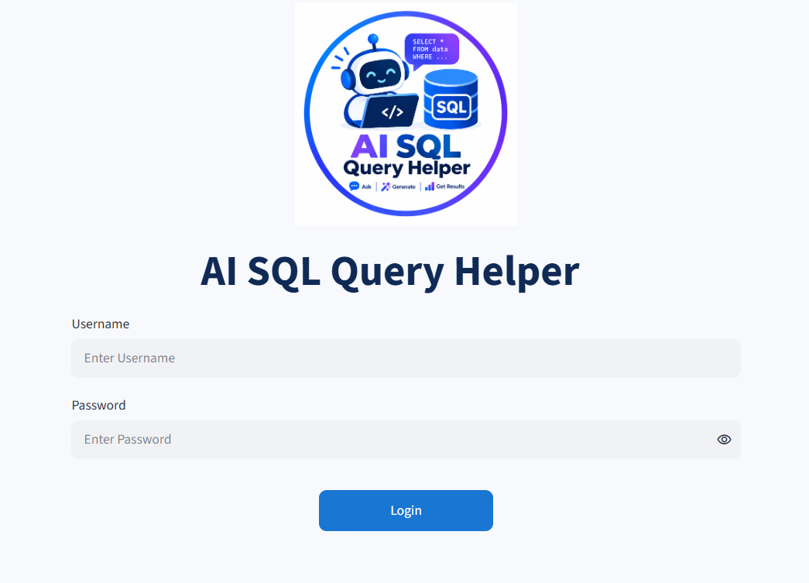
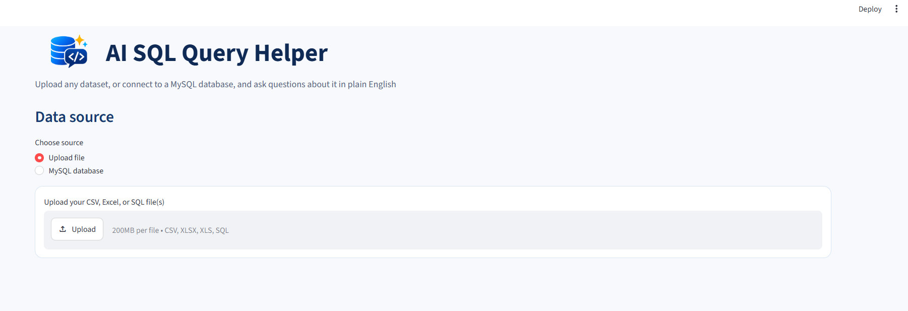
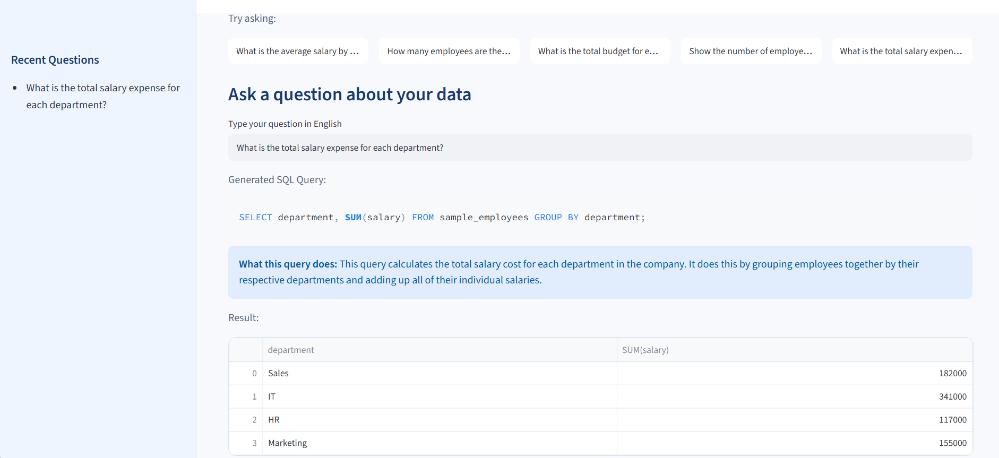
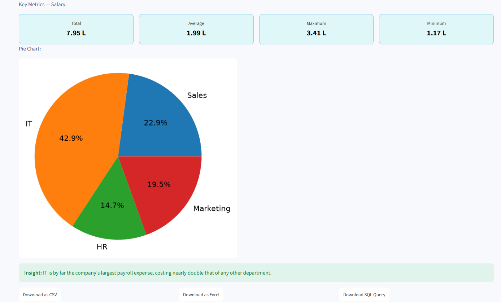
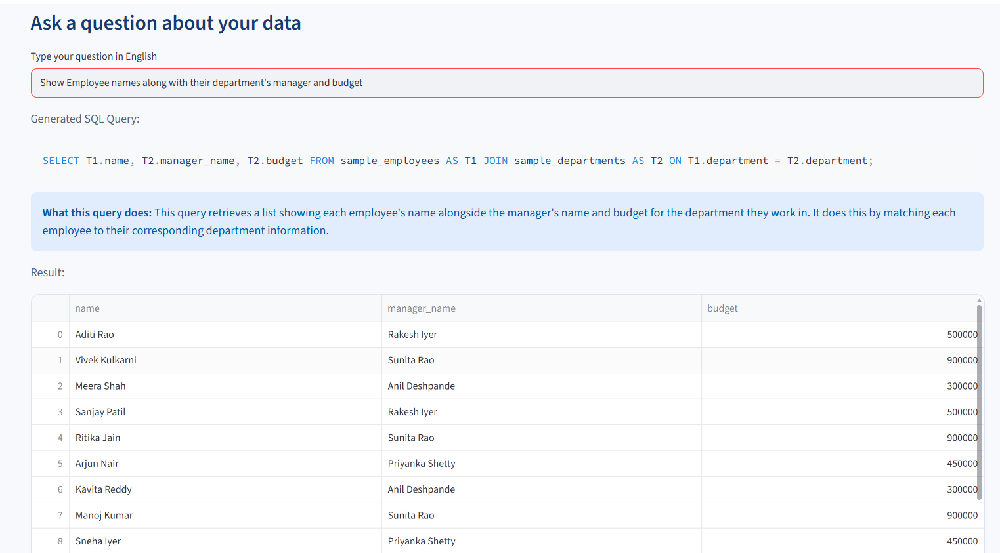

# AI-Powered SQL Query Helper

An AI-powered tool that lets you bring in data from almost anywhere — a CSV, an Excel file, a `.sql` dump, or even a live MySQL database — and ask questions about it in plain English. No SQL knowledge required. The app converts your question into a SQL query using Google's Gemini AI, runs it safely, and shows you the result instantly — complete with auto-generated charts, KPI cards, a plain-English insight, and download options.

## Features

### Flexible data sources
- **Upload CSV or Excel files** — one or several at once, each becomes its own MySQL table
- **Upload a `.sql` dump file** — the file's `CREATE`/`INSERT` statements are executed automatically and its tables become instantly queryable
- **Connect directly to an existing MySQL database** — enter host, username and password, browse all databases on that server, and pick one from a dropdown
- **Automatic date format handling** — date columns in any common format (DD-MM-YYYY, DD/MM/YYYY, etc.) are auto-detected and standardized

### Understanding your data
- **Data Profile** for every uploaded file — row/column counts, missing values, column data types, and summary statistics for numeric columns
- **Dynamic schema detection** — the app reads the real structure of every table, so it works with any dataset, including multiple tables at once
- **Cross-table (JOIN) support** — Gemini can generate queries that join data across uploaded tables (e.g. linking employees to their department's manager and budget)
- **Auto-suggested questions** — 5 relevant starter questions are generated from your data's schema and shown as clickable buttons

### Asking and understanding questions
- **English to SQL conversion** powered by Google Gemini AI
- **Transparent SQL generation** — the generated query is always shown, with a plain-English explanation of what it does
- **Built-in safety guardrail** — only `SELECT` queries are allowed; anything else (`DELETE`, `DROP`, `UPDATE`, etc.) is blocked before it ever runs
- **Irrelevant question handling** — if a question can't be answered from the data, the app shows a clear warning instead of a broken query
- **Friendly error handling** — if the AI's free daily usage limit is reached, the app shows a plain message instead of crashing

### Results that are easy to read
- **KPI Summary Cards** — Total, Average, Maximum and Minimum for numeric results, styled as cards and formatted in the Indian numbering system (K / L / Cr)
- **Auto-selected charts** — a line chart for trends over time, a pie chart for a handful of categories, or a bar chart for many categories — chosen automatically based on the result shape
- **AI-generated insight** — a one-line, plain-language observation about the result
- **Download results** as CSV, Excel, or the raw SQL query itself

### Access
- Simple login screen to gate access to the app

## How It Works

1. **Choose a data source** — upload CSV/Excel/SQL files, or connect to an existing MySQL database
2. The data is loaded into MySQL (if not already there), with dates normalized and a schema extracted
3. **Pick a suggested question or type your own** in plain English
4. **Gemini AI** reads the schema and converts the question into a valid SQL `SELECT` query (joining tables if needed)
5. The app checks the query for **relevance and safety** — irrelevant or non-SELECT queries are blocked with a clear message
6. The query runs, and the result is shown as a table, with **KPI cards**, an **auto-selected chart**, and an **AI insight**
7. The question is added to your **recent history**, and the result can be **downloaded** as CSV, Excel, or SQL

## Tech Stack

| Component | Technology |
|---|---|
| Frontend / UI | Streamlit |
| Database | MySQL |
| AI Model | Google Gemini API (gemini-3.6-flash) |
| Data Handling | Pandas, SQLAlchemy |
| Charts | Streamlit native charts, Matplotlib |
| Language | Python |

## Example Questions

- "Which department has the highest average salary?"
- "Show me all employees from Pune"
- "List employees who joined after 2022"
- "Show total budget for each department"
- "Show employee names along with their department's manager and budget" *(cross-table join)*
- "Show total spent by each city" *(from a `.sql` upload)*

## Safety Design

This project intentionally restricts the AI to **read-only** operations. Even if a user asks a question that implies deleting or modifying data (e.g. *"delete all employees from sales"*), the generated query is checked before execution — if it isn't a `SELECT` statement, it is blocked and never runs. This was verified in testing: a delete-style question was correctly caught and refused. This design choice prevents accidental or malicious data loss from AI-generated queries.

## Challenges Faced

- **Inconsistent date formats across datasets:** date-based queries silently returned empty results when a CSV used `DD-MM-YYYY` instead of `YYYY-MM-DD`. Solved by auto-detecting date-like columns and standardizing their format at upload time, regardless of the source file's format.
- **Preventing destructive AI-generated queries:** since an LLM can technically generate any SQL statement, a safety check restricts execution to `SELECT` queries only — explicitly tested with a delete-style question to confirm it gets blocked.
- **Handling the AI's free-tier usage limits gracefully:** the Gemini free tier has a daily request limit, and a single question can trigger multiple AI calls (SQL generation, explanation, insight). Each of these calls is now wrapped so a quota error shows a friendly message instead of crashing the app.
- **Supporting any dataset, not just one:** instead of hardcoding a schema, the app reads each table's actual structure at runtime — this also made it possible to support multiple files, `.sql` dumps, and live database connections through the same question-answering flow.

## Setup / Running Locally

1. Clone this repository
2. Install dependencies:
   ```
   pip install streamlit pandas mysql-connector-python sqlalchemy python-dotenv google-generativeai matplotlib openpyxl
   ```
3. Create a `.env` file in the project root with your Gemini API key:
   ```
   GEMINI_API_KEY=your_key_here
   ```
4. Make sure MySQL is running locally and update the database credentials in `streamlit_app.py`
5. Run the app:
   ```
   streamlit run streamlit_app.py
   ```

## Screenshots


*Login screen with custom logo*


*Choosing between file upload and a live MySQL database connection*


*Asking a question in English and viewing the AI-generated SQL query with its explanation*


*KPI summary cards and an automatically chosen chart for the result*


*A question answered by joining two uploaded tables*

> Screenshot files should be placed in a `screenshots/` folder in the repository, named as referenced above.

## Author
Shruti Baviskar — Data Analytics enthusiast, building AI-powered tools for data exploration.
